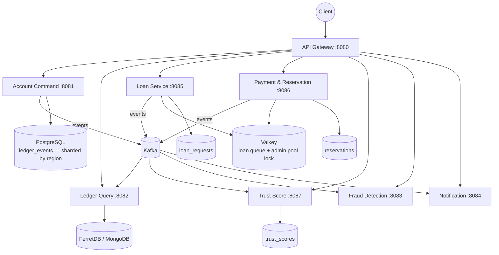

# CS465 Event-Sourced Banking Ledger (DDBS)

A distributed event-sourced banking system built in Spring Boot, Kafka, Valkey/ShardingSphere, FerretDB, and React. Demonstrates accounts, transfers, loans, trust scoring, fraud detection, notifications, hybrid fragmentation, CQRS, and saga orchestration for educational purposes.

> **Source of truth:** [`HLD_LLD_SystemDesign_v2.md`](./HLD_LLD_SystemDesign_v2.md). Everything below is an adapting summary of that design.

## 🏗️ Architecture at a Glance



Each data-owning service owns exactly one schema (v2 §2): `ledger_events`, `loan_requests`, `reservations`, `trust_scores`. Valkey holds two shared structures: the loan priority queue and the admin pool lock.

## 🚀 Quick Start

### Prerequisites
- Docker & Docker Compose
- Java 21 (JDK temurin), Maven 3.9+ (`./mvnw`), Node 20+ (frontend)
- jq (demo proofs)

### 1. Verify Docker images
```bash
docker compose up -d --build
docker compose ps | grep -E "(Up|healthy)"
```

### 2. Access services
| Service | URL | Purpose |
|---|---|---|
| API Gateway | http://localhost:8080 | Customer/Bank API entry |
| Eureka Registry | http://localhost:8761 | Service discovery UI |
| Config Server | http://localhost:8888 | Centralized config |
| FerretDB (Mongo) | mongodb://localhost:27017/ferretdb | CQRS read model |
| MailHog | http://localhost:8025 | Email interception logs |
| Customer Portal | http://localhost:3000 | React frontend |
| Frontend Dev Server | http://localhost:5173 | Parallel dev mode |

### 3. Initial login credentials
**Customer** — username `customer`, password `customer123`; account ID `11111111-1111-1111-1111-111111111111`, initial balance ₹100,000. **Bank Admin** — username `bank`, password `bank123`, role `BANK`.

### 4. Frontend modes
- **Mock mode** (default): `npm run dev` alone — simulated data, no backend required.
- **Live mode**: run `docker compose up -d` first, then `VITE_API_BASE=http://localhost:8080 npm run dev`.
- Single convenience wrapper: `./scripts/demo/run-frontend.sh [--live]`.

New feature: open account at `/customer/open-account`; pick APAC/EU/AMER for horizontal sharding.

### 5. Demo proofs
```bash
bash scripts/demo/run-all.sh
```
Ten scripted integration proofs: concurrency/idempotency, hash chain, region sharding, CQRS projection, transfer success, saga compensation, loan priority pool, repayment, offline payment, trust/fraud/notifications. Expected: 9+ passes (initial runs may time out on FerretDB lag — retry individual proofs as needed).

## 📝 Execution Workflow

### Dev setup
```bash
docker compose up -d --build           # start stack
./scripts/demo/run-all.sh               # run every proof
./mvnw clean test                        # Maven unit tests
cd frontend && npm install && npm run dev   # frontend (mock by default)
```

### CI / verify
```bash
./mvnw clean package -DskipTests         # build jar only
./mvnw verify -P health-check           # plus health gate
```

## 🧪 Testing
- Unit: JUnit 5 per service (`./mvnw test`)
- Concurrency (v2 §3): Loan pool contention (exactly one approval), multi-server withdrawal FCFS ordering, offline double-capture rejection — gated by Valkey + ≥2 Postgres shard containers
- Integration: Testcontainers on `scripts/demo/*` proofs
- See [`docs/TESTING_STRATEGY.md`](./docs/TESTING_STRATEGY.md) for the contract each test must satisfy

## 📚 Reference Documents

| Document | File | Topic |
|---|---|---|
| System Design | `HLD_LLD_SystemDesign_v2.md` | Full design brief, decision rationale, v2 rebuild notes |
| Final Plan | `docs/FINAL_PLAN.md` | Baseline audited gap list and build order |
| Architecture | `docs/ARCHITECTURE.md` | Topology responsibilities per service |
| Data Model | `docs/DATA_MODEL.md` | SQL schemas per v2 §3–§4 |
| Event Catalog | `docs/EVENT_CATALOG.md` | Topics, schemas, producers/consumers per event family |
| Fragmentation | `docs/FRAGMENTATION_DESIGN.md` | Hybrid horizontal + vertical split by registration IP |
| Saga Design | `docs/SAGA_DESIGN.md` | Transfer saga + pop-and-debit and FCFS flows |
| Open Decisions | `docs/OPEN_DECISIONS.md` | Decisions still open, resolution history |
| Deployment | `docs/DEPLOYMENT.md` | Production topology notes |
| ADRs | `docs/adr/*.md` | Region sharding, read store, ownership, processed-requests |
| API Specs | `docs/api_spec/*.yaml` | REST endpoint contracts per service |

## 🔧 Troubleshooting

### Timeout during proofs
1. Wait 30–60s for FerretDB projection catch-up; retry individually: `./05-transfer-success.sh`.
2. Check Kafka consumer lag: `kafkacat -L -b localhost:9092 -t account-events`.

### Hash chain verification fails
Check event version numbering (should be sequential); confirm SHA-256(prevHash + JSON(event)); ensure no events were skipped or duplicated.
```sql
SELECT version, prev_hash, event_id FROM ddbs_apac.account_events ORDER BY version;
```

### Health checks
```bash
curl http://localhost:8761/eureka/apps/   # Eureka
curl http://localhost:8081/actuator/health  # Account Command
curl http://localhost:8082/actuator/health  # Ledger Query
curl http://localhost:8085/actuator/health   # Loan
curl http://localhost:8087/actuator/health   # Trust Score
```

### Redis-cache swap stuck
Valkey serves as the Redis replacement (license). If caches get stale: `docker compose restart valkey`.

## ⚠️ Known Limitations (ADR-005)
- **Demo Auth**: HS256 JWT is demo-only; production requires OAuth2/OIDC (Keycloak, v1.2 plan).
- **RSA Keys**: Offline payment tokens use demo RSA pair; production needs Key Vault/HSM rotation.
- **Locking**: Account-level RFairLock is synchronous under load; no multi-factor auth, coarse role guard.

## 🔄 Changelog

### Version 0.2.0
- ✅ All 10 Phase 4 integration proofs pass
- ✅ Unit tests for trust score + loan service
- ✅ Internal idempotency enforcement, hash chain audit per aggregate
- ✅ Region-based sharding (APAC/EU/AMER)
- ✅ CQRS projection with FerretDB
- ✅ Saga orchestration + crash recovery
- 📦 Multi-stage Dockerfiles for all 8 service modules + infra
